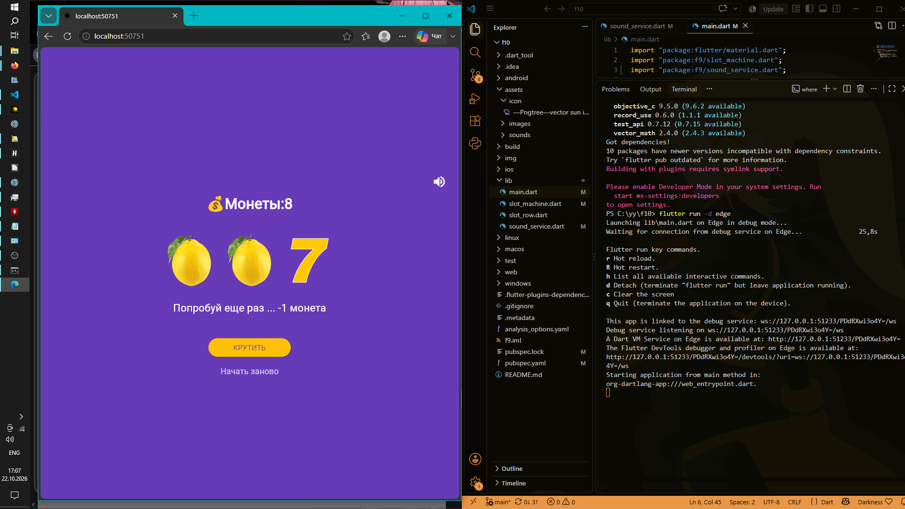
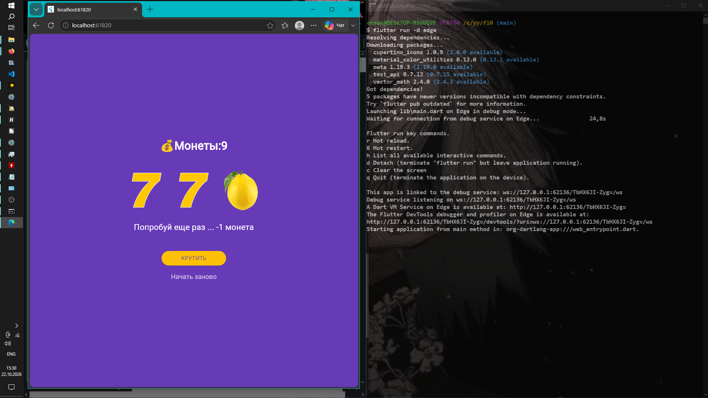

# Flutter 10

## Автор

**Фамилия Имя** : Чумаченко Михаил
**Группа** : ИСП-242


## Скриншоты





## Как играть

* Нажмите **КРУТИТЬ**, чтобы запустить барабаны.
* Три одинаковых символа — победа (+3 монеты).
* Три семёрки — джекпот (+10 монет).
* Разные символы — проигрыш (-1 монета).
* Начните заново кнопкой **Начать заново**.

## Запуск проекта

```bash
# Клонировать репозиторий
git clone < url >

# Перейти в папку
cd f10

# Установить зависимости
flutter pub get

# Запустить в Edge
flutter run -d edge
```


## 🛠️ Технологии

* **Flutter** 3.47.7
* **Dart** 3.13.5
* **Платформы:** Web

## 📚 Что изучено

* `StatefulWidget` и управление состоянием через `setState()`
* Работа с локальными изображениями через `Image.asset()`
* Генерация случайных чисел через `dart:math`
* Анимация через `async/await` и `AnimatedOpacity`
* Подключение иконки приложения через `flutter_launcher_icons`
* Сборка под Web 

